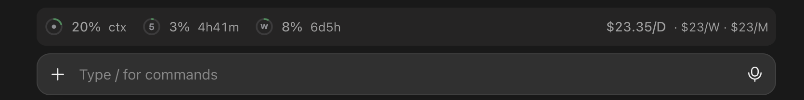
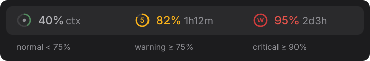

# claude-usage-band

[中文](#中文) | [English](#english)



## 中文

在 Claude Code 输入框上方显示一行用量信息：上下文占用，5 小时与 7 天限额窗口的已用比例、窗口内估算费用及重置倒计时，以及今日、本月的估算费用。

```
◑ 50% ctx · ○ 3% $8.4 5h · 4h22m · ◔ 25% $128 7d · 4d17h · $12.50/D · $300/M
```

桌面 app 中每个百分比带一个小圆环，终端中显示为饼图字符。

### 显示内容

| 项目 | 含义 |
| --- | --- |
| `ctx` | 上下文占用，按自动压缩窗口计算（与 `/context` 一致） |
| `5h` / `7d` | 5 小时、7 天限额已用比例、该窗口内的估算费用，及距重置的时间 |
| `/D` `/M` | 今日、本月的估算费用 |



- 颜色与 app 自带的用量弹窗一致：75% 以下正常，75% 起黄色，90% 起红色。
- 窗口费用按限额自身的窗口计算（重置时间减去 5 小时或 7 天），不是自然日或自然周；没有限额窗口时（如使用 API key）不显示。
- `/M` 后出现 `*` 表示有模型价格未知，未计入。

### 安装

在终端 Claude Code 会话中：

```
/plugin install usage-band --marketplace guoggg/claude-usage-band
```

或在 shell 中：

```bash
claude plugin install usage-band --marketplace guoggg/claude-usage-band
```

桌面 app：点击输入框旁的 **+** → **Plugins** → **Add marketplace**，填入 `guoggg/claude-usage-band`，再点 **Add plugin**。

添加 marketplace 时输入 `y`，范围选 user；下次刷新输入框时即可看到。

### 环境要求

- 支持 mod（hooks 模块）的 Claude Code 版本；在 2.1.309 上开发和测试。
- `/usr/bin/python3`（macOS / Linux），用于计算费用。暂不支持 Windows。

### 隐私

所有数据只在本地处理。费用由 `scripts/scan.py` 计算：读取 `~/.claude/projects`（或 `$CLAUDE_CONFIG_DIR/projects`）下的会话记录，缓存写入 `~/.cache/claude-usage-band/`，不做任何网络请求。

### 关于费用

费用是根据每次响应的 token 用量和内置价格表（`scripts/scan.py` 中的 `PRICES`）算出的 **API 等价估算值**。订阅用户的实际扣费与此无关；价格可能变化，仅供参考。欢迎提 PR 更新价格。

### 许可

MIT

---

## English

A one-line usage band above the Claude Code prompt: context fill, the five-hour and seven-day limit windows with their usage, estimated in-window cost and reset countdowns, and estimated cost for today and this month.

```
◑ 50% ctx · ○ 3% $8.4 5h · 4h22m · ◔ 25% $128 7d · 4d17h · $12.50/D · $300/M
```

In the desktop app each percentage gets a small ring; in the terminal, a pie glyph.

### What it shows

| Item | Meaning |
| --- | --- |
| `ctx` | Context used, against the auto-compact window (same as `/context`) |
| `5h` / `7d` | Five-hour and seven-day limit usage, estimated cost within that window, and time until reset |
| `/D` `/M` | Estimated cost today, this month |


- Colors follow the app's own usage popover: normal below 75%, amber from 75%, red from 90%.
- Window cost follows each limit's own window (its reset minus five hours or seven days), not a calendar day or week; it is hidden without the window (e.g. on an API key).
- A `*` after `/M` means some models had no known price and were left out.

### Install

In a terminal Claude Code session:

```
/plugin install usage-band --marketplace guoggg/claude-usage-band
```

Or from a shell:

```bash
claude plugin install usage-band --marketplace guoggg/claude-usage-band
```

In the desktop app: click **+** next to the prompt box → **Plugins** → **Add marketplace** with `guoggg/claude-usage-band`, then **Add plugin**.

Answer `y` to add the marketplace and pick the user scope; the band appears once the prompt is drawn again.

### Requirements

- A Claude Code version that supports mods (hooks modules); built and tested on 2.1.309.
- Python 3 at `/usr/bin/python3` (macOS / Linux), used for the cost scan. Windows is not supported yet.

### Privacy

Everything stays on your machine. Cost is computed by `scripts/scan.py`, which reads the transcripts under `~/.claude/projects` (or `$CLAUDE_CONFIG_DIR/projects`) and keeps a cache in `~/.cache/claude-usage-band/`. Nothing is sent over the network.

### About the cost

Cost is an **API-equivalent estimate** from each response's token usage and a built-in price table (`PRICES` in `scripts/scan.py`). On a subscription it is not what you are billed; prices may change, so treat it as a rough gauge. Pull requests to update prices are welcome.

### License

MIT
